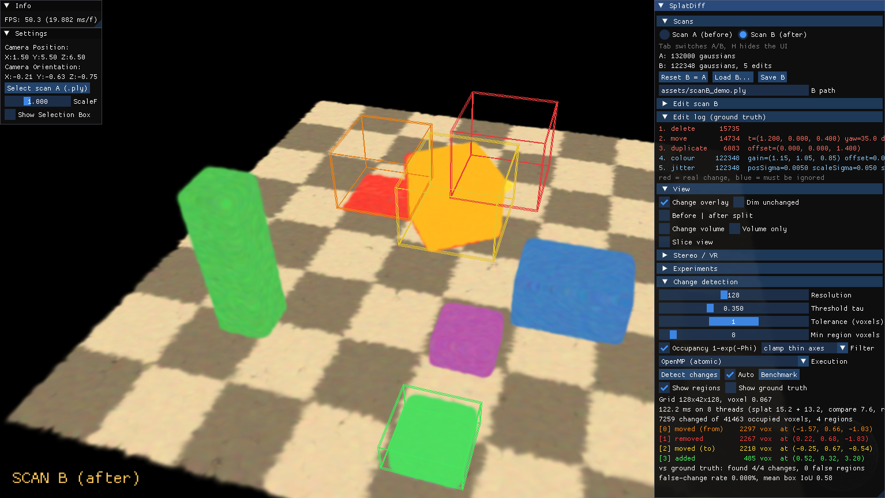
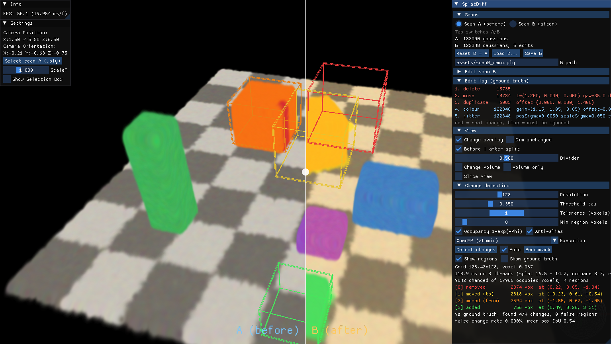
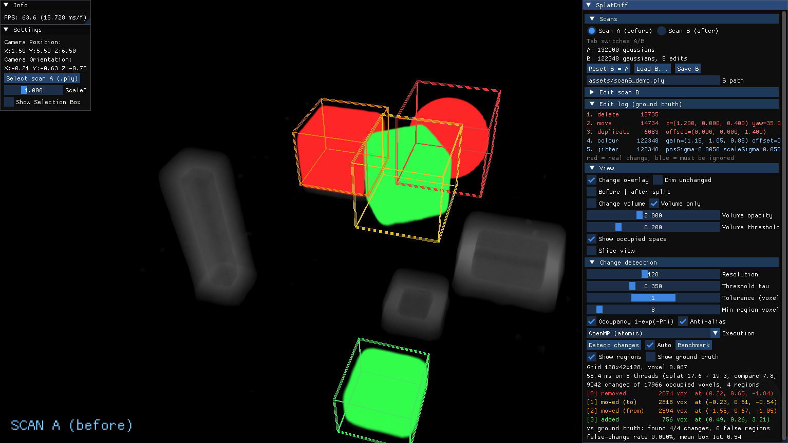
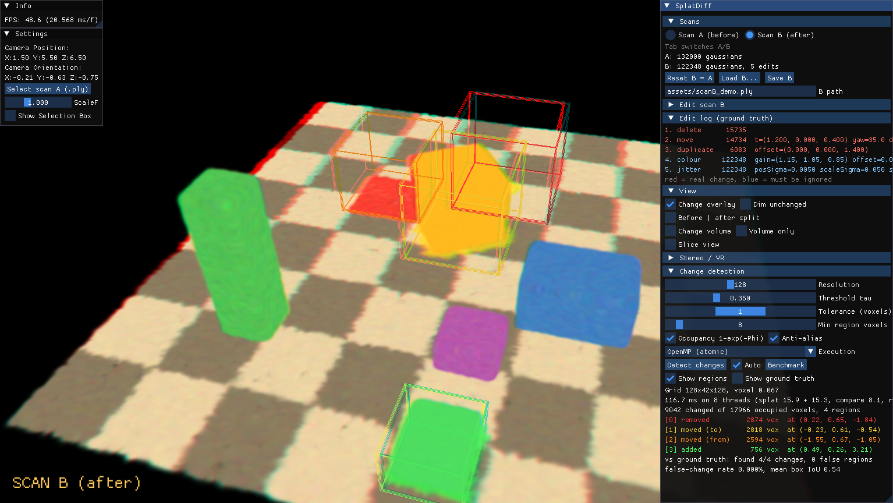
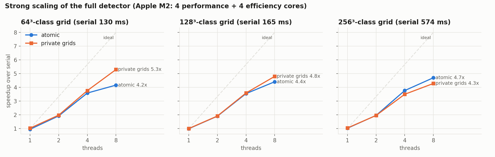

# SplatDiff

**Find what changed between two 3D Gaussian Splatting scans of the same place.** SplatDiff turns each scan into a
colour-free voxel density field, subtracts them, and reports every object that was added, removed or moved. It
ignores re-scan noise and lighting changes. An OpenGL viewer shows the changes in 3D, with a before/after slider,
a volume X-ray and a stereo/VR mode. The detector runs serially or in parallel with OpenMP.

C++17 · OpenGL 3.3 · SDL2 · Dear ImGui · OpenMP



| Before / after slider | Change volume (X-ray) | Red/cyan stereo |
|---|---|---|
|  |  |  |

## Results

On the synthetic room (132k Gaussians, Apple M2):

* **13/13 test cases pass.** Every real change (delete, move, move + rotate, duplicate, small move, all combined)
  is found with no false regions. Re-scan noise (jitter, split, prune) and lighting changes flag **0 voxels**.
* **4.7× faster with OpenMP** than serial, for the whole detector at 256³ (574 ms → 122 ms on 8 threads).



More figures in [`docs/figures`](docs/figures).

## Quick start

macOS (Homebrew):

```bash
brew install cmake sdl2 glew glm nlohmann-json llvm
```

Ubuntu / Debian:

```bash
sudo apt install cmake g++ libsdl2-dev libglew-dev libglm-dev nlohmann-json3-dev
```

Build, test, and make the demo scans:

```bash
make build
./build/splatdiff_tests
python3 tools/make_synthetic_scene.py assets/synthetic_room.ply
./build/splatdiff_edit assets/synthetic_room.ply assets/scanB_demo.ply --seed 42 \
  --delete 0.2 0.62 -1.8  0.65 0.6 0.65 \
  --move -1.5 0.535 -1.0  0.55 0.515 0.55  1.2 0 0.4  35 \
  --duplicate 0.5 0.215 1.8  0.35 0.195 0.35  0 0 1.4 \
  --colour 1.15 1.05 0.85 0.03 --jitter 0.005 0.05
```

Open the viewer:

```bash
./splatdiff assets/synthetic_room.ply --scan-b assets/scanB_demo.ply --detect --split
```

Any 3DGS `.ply` file (the standard INRIA format) works as scan A.

### Controls

| | |
|---|---|
| Left-drag | look around |
| W A S D, Space / C | move, up / down (Shift = faster) |
| Tab | switch between scan A (before) and scan B (after) |
| H | hide the panel (clean screen for VR) |
| Q | quit |

The **SplatDiff** panel on the right has every feature: edit scan B, detect changes, change the view, stereo/VR,
and run the experiments.

## How it works

The detector is in [`src/ChangeDetect.cpp`](src/ChangeDetect.cpp) and never uses colour, so lighting changes
can't cause false alarms.

1. **Splat to a density field.** Each scan is splatted into a voxel grid:
   Φ(v) = Σᵢ αᵢ exp(−½ dᵀ Σᵢ⁻¹ d). Each covariance's eigenvalues are first clamped to at least (voxel/2)², so very
   thin Gaussians such as floors and walls can't slip between voxel centres. The density is converted to
   occupancy, O = 1 − exp(−Φ), which saturates inside solid objects so re-scan noise cancels out.
2. **Compare.** A voxel is *added* if O_B − max₃ₓ₃ₓ₃(O_A) > τ, and *removed* for the reverse. The 1-voxel
   neighbourhood absorbs small position jitter.
3. **Find regions.** Changed voxels are grouped into 26-connected components. A removed region and an added
   region of similar size and shape (D1 shape histogram) are reported as one *moved* object.

Each of the three kernels runs in one of three modes: serial, OpenMP with atomic adds, or OpenMP with
per-thread private grids and a reduction.

### Viewer (OpenGL)

* **Change overlay:** each Gaussian is tagged with its change region through a per-vertex buffer and tinted in
  the vertex shader. *Dim unchanged* greys out everything else.
* **Before/after slider:** both scans are drawn with `glScissor` on either side of a draggable divider.
* **Change volume:** both occupancy grids are uploaded as one RG16F 3D texture and ray-marched per pixel, with a
  slab test, front-to-back compositing and early ray termination.
* **Slice view:** a heatmap of any axis-aligned cross-section of the grid.
* **Stereo / VR:** off-axis (asymmetric frustum) stereo, rendering each eye to its own framebuffer. The two eyes
  are combined as red/cyan anaglyph, side-by-side, or Google Cardboard with barrel lens pre-distortion
  r′ = r(1 + k₁r² + k₂r⁴). Toe-in stereo is included for comparison.
* **Projection fix:** the original renderer used the window width for the vertical focal length, which stretched
  every splat by the aspect ratio. It now uses H / (2 tan(fovy/2)) for both axes.

### Scan editing and ground truth

[`src/SceneEdit.cpp`](src/SceneEdit.cpp) makes scan B from scan A in two ways.

*Real changes* (should be found):
* move or rotate;
* delete;
* duplicate.

*Re-scan effects* (should be ignored):
* lighting / colour change;
* position and scale jitter;
* splitting Gaussians;
* pruning faint Gaussians.

Covariances are transformed as Σ′ = LΣLᵀ. Every edit is written to a JSON log, which is the ground truth used to
score the detector.

## Experiments

```bash
./build/splatdiff_experiments assets/synthetic_room.ply --out assets/experiments
python3 tools/plot_results.py assets/experiments
```

The suite ([`src/Experiments.cpp`](src/Experiments.cpp)) runs on any scan A. It picks edit regions automatically
and runs 13 cases:

* **stability:** jitter, strong jitter, split, prune, and all of them together;
* **appearance:** global and local colour changes;
* **real changes:** delete, move, move + rotate, duplicate, small move, and all combined.

It also runs three sweeps: the threshold τ, the grid resolution, and the thread count. The same suite is in the
viewer's **Experiments** panel, where **Show** loads any case.

### Findings

* **Filter choice.** Mip-Splatting's mass-preserving filter makes thin, opaque surfaces almost invisible, so a
  deleted floor patch is missed. Dilating every axis fixes that but gives loose boxes. Clamping only the thin
  axes keeps thin surfaces visible and gives the tightest boxes:

  | filter (`--filter`) | demo IoU | false change on re-scans | suite | thin-floor hole |
  |---|---|---|---|---|
  | clamp (default) | 0.58 | 0 | 13/13 | found |
  | dilate | 0.47 | 0 | 13/13 | found |
  | mass | 0.54 | 0 | 13/13 | missed |
  | none | 0.64 | 1,085 / 11,123 voxels | 12/13 | n/a |

* **Honest serial baseline.** Serial mode pins OpenMP to one thread for the whole pipeline. An early version left
  parts of it parallel, which understated every speedup. A test now checks this.
* **Where the time went** (profiled, not guessed). Region labelling is negligible. The real serial bottleneck was
  computing the grid bounds: 23% of the parallel time at 64³. It now uses a parallel, sampled percentile.
* **Heterogeneous cores.** The M2 has 4 performance and 4 efficiency cores. Dynamic scheduling took the compare
  kernel from 3.4× to 4.4×. Four threads already give 3.5×, and each efficiency core adds about 0.2 of a
  performance core.
* **Atomics vs private grids.** Private grids win on small grids (4.7× at 64³). Atomics win on large ones,
  because reducing 8 copies of a big grid costs more than the contention it avoids.
* **Negative result.** Sorting Gaussians into spatial buckets for cache locality didn't help, so it was removed.

## Project layout

```
src/ChangeDetect.cpp   density field, compare, regions, OpenMP modes
src/SceneEdit.cpp      edits, covariance maths, PLY I/O
src/Experiments.cpp    the 13-case suite and sweeps
src/App.cpp, GUI.cpp   viewer and panel
src/Stereo*.cpp        stereo maths and eye compositing
src/VolumeView.cpp     3D-texture ray marcher
shaders/               GLSL (splats, volume, stereo)
tools/                 splatdiff_edit / _detect / _experiments CLIs, scene generator, plotting
tests/                 unit tests
```

## Credits

The Gaussian splat loading and base renderer are adapted from
[Gaussian-Splat-Editor](https://github.com/jason9075/Gaussian-Splat-Editor) by Jason Kuan (MIT). Dear ImGui,
ImGuiFileDialog and happly are included under their own licences. See [`LICENSE`](LICENSE).
